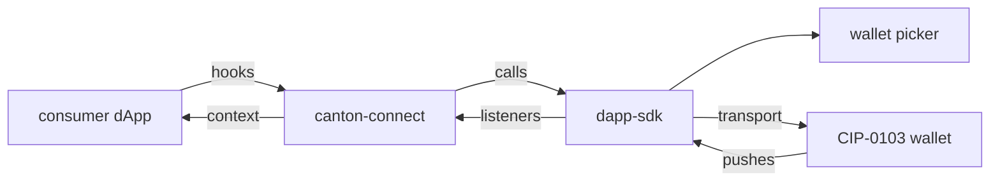

# Architecture: canton-connect

What the package is and how to use it: [`README.md`](README.md). This file maps the seams. Two
subsystems carry their own chapter:
[`architecture/connection-machine.md`](architecture/connection-machine.md) for the states and what
settles each promise, and [`architecture/popup-close-guard.md`](architecture/popup-close-guard.md)
for the SDK bug the guard works around.

## Project structure

```
src/
  machine/
    connectionMachine.ts    the lifecycle; owns the sdk, account, status and the last error
    connectionActors.ts     init / connect / restore / disconnect / walletEvents
    accountsMachine.ts      the account read, invoked inside session.authenticated
    accountsActors.ts       listAccounts reader and accountsChanged listener
  CantonConnectProvider/
    index.tsx               the context: publishes the actor and four actions
    useConnectionActor.ts   creates the actor, sends the boot restore
    useConnectBridge.ts     connect() as a promise over the machine's tags
    useDisconnectBridge.ts  disconnect() as a promise over the machine's tags
    adapters.ts             buildAdditionalAdapters
  hooks/                    the public hooks, plus useTxFeed and useWalletCall
  mock/mockAdapter.ts       createMockAdapter, a ProviderAdapter for dev and tests
  testing/                  the ./testing doubles, plus suite-local helpers
  activeContracts.ts        active-contract reads: request builders, the page decoder, disclosure
  transactions.ts           update reads: request builders and the event decoder
  cantonError.ts            CantonError, isRetryable and the payload reader toError uses
  watch.ts                  WatchSource and pollEvery, what keeps useActiveContracts current
  userRights.ts             the rights read and its decoder
  connectedSynchronizers.ts the connected-synchronizers read and its decoder
  contractById.ts           the one-contract read: its request builder and decoder
  participantVersion.ts     the version read, and the floor a failed page names
  connectError.ts           ConnectCancelledError, PickerClosedError, toConnectError
  guardedConnect.ts         sdk.connect() with a closed-popup watchdog
  ledger.ts                 createLedger: every typed read over a transport the caller supplies
  core.ts                   the ./core exports, React-free
  types.ts                  Account, ConnectionStatus, CantonConnectConfig, DappSdkMethods, context value
  index.ts                  public exports
```

## Who talks to whom



| edge | what crosses it |
|---|---|
| calls | `init`, `connect`, `disconnect`, `status`, `listAccounts` from the machine's actors; `signMessage`, `prepareExecuteAndWait`, `ledgerApi` from the hooks |
| transport | extension postMessage, WalletConnect, remote gateway |
| pushes | `statusChanged`, `accountsChanged`, `txChanged` |
| listeners | `onStatusChanged`, `onAccountsChanged`, `onTxChanged` |
| context | one `CantonConnectContextValue` |

## Seams

### The lifecycle: `machine/`

One model of connecting, session, lock and disconnect, so the impossible combinations (an account
with no live session, an error beside a live session) cannot be built. Three decisions carry the weight:

- `idle` is not `disconnected`. `idle` means the boot restore has not answered; `disconnected` means
  it has, and there is nothing.
- `account` is cleared on leaving `session.authenticated`, so a wallet that will not serve requests
  publishes none. The session itself stays, which keeps the wallet listener alive: an unlock is
  heard and the account is read again with no reconnect.
- The account read is a child machine, so a failed read cannot end the session; only the promise
  carries the failure.

### The bridges

`connect()` and `disconnect()` are a send plus a wait on a tag, so the promise over a transition
lives outside the machine. Neither passes a timeout. The connect wait has no clock on purpose, since
a wallet login can take as long as it takes; it ends when the wallet answers or the user cancels
(`connect.cancel`). The disconnect wait the machine bounds itself, giving up on a wallet 10 s silent
(`DISCONNECT_TIMEOUT_MS`), since nobody is deciding anything in that window.

### The provider publishes, the hooks select

The context value is the config, the actor as `ConnectionSubscription` (`send` is unreachable
through it, so the bridges stay the only senders) and four identity-stable actions. Each hook
selects its own slice, which is wagmi's shape: `WagmiProvider` publishes, `useAccount` subscribes
itself. `useConnect`, `useDisconnect`, `useAccount` and `useWalletStatus` read session state;
`useLedger`, `useExecute`, `useSignMessage` and `usePartyType` select a guard plus the sdk and
call it directly, never entering the machine.

The machine's input is read once, when the actor is created, so a changed `config` prop needs a
remount. One accepted cost: `sdk` in context makes the snapshot unserializable, which rules out
`getPersistedSnapshot`.

### The picker, and the close guard around it

`CantonConnectConfig.walletPicker` decides the picker: omitted, the SDK's popup; injected, a custom
one (`createAutoPicker` in tests). It is fixed at `new DappSDK()`, which is why the provider hands
the machine a `createSdk` closure rather than an instance.

With the SDK popup in use, `guardedConnect` wraps `sdk.connect()` with a watchdog on the popup
window, because the SDK misses a close (#49). A caught close rejects with `PickerClosedError`, which
takes the machine to `retiring`, where the `DappSDK` is replaced. `cancelConnect` lands there too:
the guard closes the popup itself, off the abort xstate fires when it stops the connect actor.

### Adapters

`buildAdditionalAdapters` assembles what `sdk.init` registers beyond the auto-discovered extensions:
a `WalletConnectAdapter` when `walletConnectProjectId` is set, plus `config.additionalAdapters`. The
init actor passes `defaultAdapters: []`, dropping the SDK's bundled `localhost:3030` dev gateway.
`networkId` (default `'canton:local'`) is the WalletConnect `chainId`. A wallet reporting no
network on an account is not corrected: `Account` carries what it reported.

### Remote gateway

Configured like any adapter: `additionalAdapters: [new RemoteAdapter({ name, rpcUrl })]`, with
`RemoteAdapter` imported from `dapp-sdk`. Connect, restore, disconnect and execute reach a gateway
with no change to this package, and the popup-close guard behaves as it does on an extension. The
flow itself (login page, status push, review page) is the SDK's:
https://docs.canton.network/sdks-tools/sdks/dapp-sdk/wallet-providers/remote-wallet.md.

What differs on a gateway:

- Restore after a reload works only for a gateway registered through `additionalAdapters` at init:
  `RemoteAdapter.restore()` matches the stored discovery URL against a registered `rpcUrl`, so a URL
  the user typed into the SDK picker has nothing to match next time.
- No lock: a gateway has none, so `useWalletStatus().isLocked` never turns true.
- `ledgerApi` must name the route as a template with the values in `path`; a route with the value
  written in is refused. See [Ledger reads](#ledger-reads).

### WalletConnect

`walletConnectProjectId` is what makes `buildAdditionalAdapters` build the SDK's
`WalletConnectAdapter` (Adapters above). Execute, disconnect and the popup-close guard behave as on
an extension. Pairing and requests are the SDK's:
https://docs.canton.network/sdks-tools/sdks/dapp-sdk/wallet-providers/walletconnect.md.

What differs over WalletConnect:

- Restore after a reload is silent: the sign client persists the session.
- No lock reaches the dApp: `useWalletStatus().isLocked` never turns true, and a request sent to a
  locked wallet waits.
- `networkId` is the CAIP-2 chain id of the network the dApp targets: a wallet on another network
  cannot pair, and the default `canton:local` is a local participant, so a dApp on devnet or mainnet
  sets it.

### The core

`createLedger(ledgerApi)` is every typed read over a transport the caller hands it. `useLedger` is
the session guards and the connected party over one built on the wallet's `ledgerApi`, so a read is
written once and a hook-only read cannot drift from it. `/core` exports it with the types and the
React-free utilities, and imports nothing outside the package at runtime; `core.test.ts` walks the
source graph and fails the moment it does.

What the code cannot say:

- It fails the first gate on purpose. The reads are what a wallet, an indexer or a service wants,
  and none of them has a dApp's session.
- A sub-path shares its package's peers, so installing canton-connect for `/core` still puts React
  and the SDKs in the tree, though nothing loads them. A package of its own would fix that, and
  waits for a consumer that needs it.
- The transport's shape is the gateway's own: a route template with `path`, `query` and `body`,
  which `core-ledger-client`'s `LedgerClient` takes as is.

### Ledger reads

`ledgerApi` names its route the way Canton's JSON API OpenAPI does: templated, with the variable
parts in `path`, never written into the string. It is the shape the SDK's own client sends, and the
only one a gateway accepts.

```text
resource: '/v2/users/{user-id}/rights', path: { 'user-id': userId }   // the SDK's shape
resource: `/v2/users/${userId}/rights`                                // a gateway refuses this
```

`query` holds query parameters, `body` the request body; neither goes into `resource`.

The typed reads unwrap the envelope every dApp otherwise walks by hand. What the code cannot say:

- Active contracts go through `/v2/state/active-contracts-page`, not the streaming endpoint, which
  answers everything in one body and 413 past the participant's limit. The offset is read once and
  sent with every page: the participant refuses a page token issued at another offset, and one
  offset is what makes the pages one snapshot. The endpoint exists from Canton 3.5, which every
  Splice line runs. A 3.4 participant, such as `dpm sandbox` inside a project pinned to SDK 3.4,
  answers it with a bare 404, which a gateway forwards as `Something went wrong while calling
  ledgerApi`: its allowlist is the 3.5 and 3.6 routes whatever the participant runs. So a failed page reads `/v2/version`, and below 3.5 the
  read rejects naming the floor, the participant's failure as `cause`; asking only on failure is
  what keeps a paging participant at no extra call. There, `ledgerApi` on
  `/v2/state/active-contracts` is the read, unpaged, and the exported types still fit its rows.
- A contracts read answers `{ contracts, offset }`, not a bare list. The offset is the one its pages
  were pinned at, so a caller following changes resumes exactly there instead of reading the ledger
  end separately and double-counting whatever committed in between.
- `party` defaults to the connected party and takes a list. Visibility stays the ledger's: a party
  the session's user cannot read as is refused by the participant, not filtered here.
- Payloads and views are generics the caller names, on a transaction's created events as much as on
  an active contract. The package knows the envelope, not the Daml model.
- A view with a non-zero `viewStatus` is one the ledger could not compute, so the contract is
  dropped rather than returned without a value.
- Transactions are always read in the ledger-effects shape: the default drops exercised events, and
  a history or a command result is nothing without them.
- `transactions` is one page; the caller resumes from the last `offset` and pins one `endInclusive`
  across pages via `ledgerEnd`, or a later page sees what an earlier one could not.
- `transaction` uses a per-party wildcard filter so the caller sees every event of its own command.
  The any-party wildcard is admin-only on a participant.
- `contractById` reads `/v2/events/events-by-contract-id`, which answers with the create and the
  consuming archival rather than a contract, so an archived contract still comes back. The read
  reports `{ contract, archivedOffset }`: `archivedOffset` undefined is the whole of "still
  active", and where it is set it is a cursor, not a timestamp. A caller wanting only live
  contracts asks `activeContracts`; this is the read for one id already in hand.
- A create pruned out from under its archival leaves nothing to report, so `contractById` rejects
  rather than answering with half a contract. A contract the party cannot see is the participant's
  own `CONTRACT_EVENTS_NOT_FOUND`, and a malformed id its `INVALID_FIELD`; neither is restated here.
- `contractById` filters by wildcard, like `transaction`: the caller has an id, not a template.
- `userRights` answers for the ledger user the wallet authenticates as, not the connected party,
  so it lists parties the session never connected as. That user's `primaryParty` stays unread: on
  the reference gateway it is the validator's `app_user` party, and would contradict `useAccount`.
- `UserRight`'s kinds are declared, as `CantonErrorPayload` is, and `userRights.test.ts` fails
  typecheck when the spec names a kind the decoder does not know. `ParticipantPermission` is pinned
  the same way in `connectedSynchronizers.test.ts`.
- `connectedSynchronizers` takes one party, since the endpoint answers for one. It always sends it:
  asked with none, the participant answers `PARTICIPANT_PERMISSION_UNSPECIFIED` for every row. A
  party the participant does not host gets an empty list, not an error.

### Errors

Every rejection reaches the consumer as an `Error`, and as a `CantonError` where the participant
raised it. Each layer rejects with a shape of its own, so the message is read through all three
rather than stringified:

```text
{ code, message, data }                          the window transport, the error member alone
{ status, error, details }                       the SDK's own controller
{ jsonrpc, id, error: { code, message, data } }  the gateway over HTTP, envelope kept
```

What the code cannot say:

- The gateway collapses every failure to JSON-RPC `-32603` and HTTP 500, so neither discriminates.
  The participant's payload rides untouched under `error.data`, and it is the only thing that does.
- The guard is `code`, `cause` and `errorCategory` because that is what the gateway's own
  `isJsCantonError` requires before wrapping; the two must not disagree about what a Canton error is.
- `CantonErrorPayload` is declared rather than imported: `JsCantonError` lives in
  `@canton-network/core-ledger-client`, outside this package's graph and 3.8 MB with `pino` in it.
  The spec package is a dev-only dependency instead, and `cantonError.test.ts` fails typecheck if the
  shape it describes stops fitting. Canton sends its optional fields as `null` where that spec says
  `string`, so they are nullable here and absent on `CantonError`.
- `errorCategory` stays a raw number and `isRetryable` reads only `retryInfo`. Nothing in the SDK
  graph exports the fourteen category names, and the six-code list `core-ledger-client` retries on is
  that client's policy rather than the error's meaning.

### Watching a read

`useActiveContracts` is the state, effect and race guard every dApp wrote around `activeContracts`.
`watch` keeps it current by following the template's transactions from the snapshot's own offset,
never by re-reading:

```text
snapshot   activeContracts -> { contracts, offset }   the offset becomes the cursor
tick       transactions from the cursor               created adds, consuming exercised removes
```

What the code cannot say:

- Applying events by kind is sound only because the caller already filtered by template. An
  active-contract view cannot be rebuilt from events in general: a consuming exercise omits the
  archived contract's stakeholders, so it cannot say whose view it left.
- A tick is two calls, not one, since `transactions` bounds its page with the ledger end. Neither is
  a contracts read, which is the point: watching the ledger end instead re-reads every contract
  whenever anything on the participant moves.
- A followed create carries no `createdEventBlob`, so a read that asked for one re-snapshots instead.
  A contract whose blob went missing breaks a disclosure much later, where nothing points here.
- `WatchSource` takes a tick and returns its teardown, so the timer is the default rather than the
  mechanism. Nothing pushes to a browser today, which is the only reason it is a timer.

### The party type

A party under the hosting participant's namespace is local, any other is external. A dApp cares
because the reference gateway refuses `signMessage` for a local party. CIP-0103 has no field for
it, so `usePartyType().readPartyType` derives it when the consumer asks, never in the machine: one
`ledgerApi` read of the participant id (`GET /v2/parties/participant-id`, open to a `CanActAs`
token), its namespace compared with `Account.namespace`, which arrives from the wallet unchanged, as
`signingProviderId` does. A failed read rejects; what follows is the consumer's call. `isLocal` on
the parties endpoint means hosted here, external parties included, so it is not the signal.

### Testing doubles

`createFakeWallet` is a real CIP-0103 extension over `postMessage`, so a test walks the SDK's own
announce, detect and connect path. `createAutoPicker` answers the picker headlessly, and
`FakeSessionProvider` rehydrates the machine at an asked-for state with no SDK behind it.

## Deferred

- Themed in-page picker (#50): its PR (#63) was closed unmerged, so the SDK popup is still the only
  picker; a new attempt starts from the `walletPicker` seam.

For the stack around this package: the root [`architecture.md`](../architecture.md).
