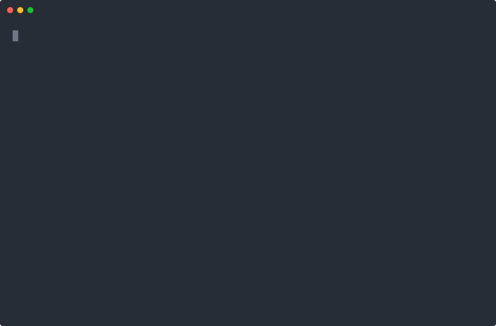

# Canton dAppBooster installer

> [Canton dAppBooster](https://dappbooster.cc) is an open-source stack by BootNode for building Canton dApps on your own machine: a local Canton Network stack, wagmi-style hooks, UI components and CIP-0103 wallet support, wired together from the local network up to the UI. The installer, the guides and the rest of the stack live at [dappbooster.cc](https://dappbooster.cc).

Scaffolds a Canton dApp: a React and Vite app on the Canton dAppBooster libraries, optionally with a local network.



## Requirements

- Node >= 24.15.0;
- npm, pnpm, yarn or bun. The installer installs the packages with the one that runs it.

The local network also needs Docker and pnpm, and building a contract needs `dpm`. Check the [documentation](https://docs.dappbooster.cc/) for more info.

## Interactive mode

```shell
pnpm create canton-dappbooster
```

> [!NOTE]
> If you cancel with Ctrl-C or a step fails, the installer cleans up after itself.

Alternatively, you can start with a preselected dApp or local network:

- **Amulet Vesting:** a vesting dApp frontend and its contracts;
- **Token Vesting:** a vesting dApp over a canton-token-forge token, with its registry;
- **Barebones:** a minimal local Canton stack for developer workflows.

With npm:

```shell
npm create canton-dappbooster -- --example amulet-vesting   # Amulet Vesting dApp
npm create canton-dappbooster -- --example token-vesting    # Token Vesting dApp
npm create canton-dappbooster -- --localnet                 # Barebones local network
```

With pnpm:

```shell
pnpm create canton-dappbooster --example amulet-vesting   # Amulet Vesting dApp
pnpm create canton-dappbooster --example token-vesting    # Token Vesting dApp
pnpm create canton-dappbooster --localnet                 # Barebones local network
```

## Non-interactive mode (agents and CI)

Without an interactive terminal the installer asks nothing, and the choices the flags leave out take the defaults marked below.

| Flag | Purpose |
|---|---|
| `[directory]` | Folder to create the project in, new or empty. Required without a terminal |
| `--example <name>` | Start from an example dApp instead of the starter. The value is a name from the dApps table, with or without `@<version>`, or a scoped package, a tarball, a git URL or a folder |
| `--localnet` | Add the Barebones local network |
| `--skip-install` | Write the files and stop before installing the packages |
| `--disable-git` | Skip the git repository. The installer also skips it when the folder is already inside one |
| `-h`, `--help` | Show the usage text |

```shell
pnpm create canton-dappbooster my-dapp                                       # starter dApp
pnpm create canton-dappbooster my-dapp --example amulet-vesting --localnet   # Amulet Vesting with Barebones
```

> [!NOTE]
> With npm, put `--` before the flags.

### dApps

| dApp | Flag | Default | Description |
|---|---|---|---|
| `Starter dApp` | none | ✓ | Barebones dApp that connects to a wallet and gives you a sample contract |
| `Amulet Vesting` | `--example amulet-vesting` | | A vesting dApp frontend and its contracts |
| `Token Vesting` | `--example token-vesting` | | A vesting dApp over a canton-token-forge token, with its registry |

### Local networks

| Local network | Flag | Default | Description |
|---|---|---|---|
| `No localnet` | none | ✓ | You provide your own |
| `Barebones` | `--localnet` | | Minimal local Canton stack for developer workflows |

How a run builds a project is in [`architecture.md`](https://github.com/BootNodeDev/canton-dappbooster/blob/main/canton-create/architecture.md).
