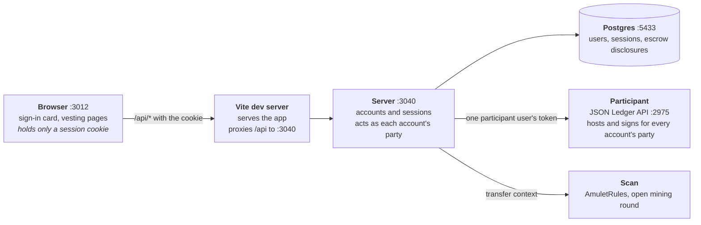
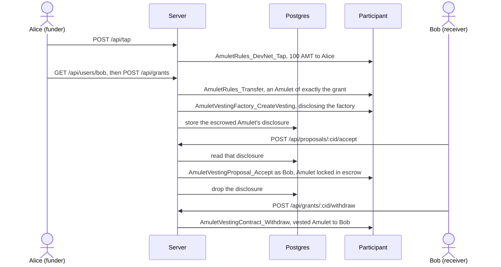

# Amulet vesting dApp, wallet-less

> [Canton dAppBooster](https://dappbooster.cc) is an open-source stack by BootNode for building Canton dApps on your own machine: a local Canton Network stack, wagmi-style hooks, UI components and CIP-0103 wallet support, wired together from the local network up to the UI. The installer, the guides and the rest of the stack live at [dappbooster.cc](https://dappbooster.cc).

`@bootnodedev/canton-example-amulet-vesting-walletless` is the [amulet-vesting](https://github.com/BootNodeDev/canton-dappbooster/tree/main/example-dapps/amulet-vesting) dApp with no wallet. People sign in with a username and a password, and a server beside the dApp acts on the ledger as each account's own party. This README covers what changes; the rest works as amulet-vesting describes.

> [!WARNING]
> The participant signs for every account's party, so whoever runs the server and the participant holds every account's Canton Coin. That is the price of needing no wallet.

## Run the app

You need Node 24.15 or later, pnpm, the Daml SDK 3.5 (`dpm`), and Docker running.

1. Create a project from this example, with the local network.

   ```bash
   pnpm create canton-dappbooster --example amulet-vesting-walletless --localnet
   ```

2. In the project folder, start everything: LocalNet, contract, the server and its Postgres, and the dApp.

   ```bash
   pnpm stack up
   ```

3. Open http://localhost:3012 and create an account. The server gives it a party of its own on the participant.
4. In the account menu, use **Tap Amulet** to get 100 AMT. After a fresh LocalNet start, it fails until the first mining round opens, about ten minutes later.
5. Create a grant for a second account by its username. To accept and claim it, sign in as that account in another browser or a private window.

`pnpm stack up` also starts the Wallet Gateway the local network comes with. This app never calls it.

## How it works



The vesting flow is the one [amulet-vesting](https://github.com/BootNodeDev/canton-dappbooster/tree/main/example-dapps/amulet-vesting#how-it-works) shows, with these differences:

- a sign-in card stands where the wallet picker was, and a session cookie where the wallet session was;
- a signup allocates a party on the participant and lets the server's one participant user act as it;
- every read and write goes through the server, which acts only as the signed-in account's party, so no write asks for an approval;
- the server keeps the funder's escrowed Amulet in Postgres between the grant and its acceptance, so the funder and the receiver can be in different browsers.



The server's API, all JSON on the dApp's own origin:

| Route | What it does |
| --- | --- |
| `POST /api/auth/signup`, `/login`, `/logout`, `GET /api/session` | the account and its session |
| `GET /api/status` | whether the vesting deployment is on the ledger |
| `GET /api/vesting`, `/api/balance` | the signed-in party's grants and its free Amulet |
| `GET /api/grants/:cid/claims` | a grant's claim history |
| `GET /api/users/:username` | a username's party, for the grant form |
| `POST /api/grants` | propose a grant |
| `POST /api/proposals/:cid/accept` | accept one |
| `POST /api/grants/:cid/withdraw`, `/cancel` | claim from a grant, or cancel it |
| `POST /api/claims/:cid/withdraw` | claim a residual |
| `POST /api/tap` | 100 Amulet from the faucet, on LocalNet and DevNet |

## Configure the app

The server reads its variables from `.env` in the project folder, and [`.env.example`](.env.example) lists them. The dApp reads none: it only talks to the server. The URL variables default to the local stack.

### Use your own network

Point `.env` at your network: `CANTON_JSON_API_URL`, `SPLICE_SCAN_API_URL`, `CANTON_BACKEND_TOKEN`, and `SPLICE_TAG` for the contract build. Build and deploy the contract as [`daml/README.md`](daml/README.md) describes, then run:

| Script | What it does |
| --- | --- |
| `pnpm bootstrap` | creates the operator and its factory |
| `pnpm stack:up` | starts Postgres on `localhost:5433` and the server on http://localhost:3040 (`pnpm stack up` runs it for you on the local network) |
| `pnpm dev` | serves http://localhost:3012 |

`bootstrap` creates only what is missing, so running it again is safe. `pnpm stack:down` stops the server and Postgres and keeps the accounts.

A hosted validator issues its own tokens. Set the `EXTERNAL_OAUTH_*` keys and the server fetches one by client-credentials grant instead of minting it. `bootstrap` does not read those keys: run it with `CANTON_BACKEND_TOKEN` set to a token for that same client, so the operator it creates is one the server can act as.

### Accounts

- Accounts live in the Postgres `server/compose.yaml` starts. Set `DATABASE_URL` to use another one, and `stack:up` applies the schema there.
- An account names a party on the ledger. After `canton-barebones reset`, wipe the accounts too: `docker compose -f server/compose.yaml down -v`.
- Each account adds one right to the server's participant user, and a participant caps a user at 1000 rights, so one deployment holds at most 1000 accounts.
- `GET /api/users/:username` lets any signed-in account find any other by name, so treat usernames as public.
- Set `WL_COOKIE_SECURE=true` once the app is served over https.

[`architecture.md`](https://github.com/BootNodeDev/canton-dappbooster/blob/main/example-dapps/amulet-vesting-walletless/architecture.md) describes the server, the session and the reasoning behind them, and [`PROVENANCE.md`](https://github.com/BootNodeDev/canton-dappbooster/blob/main/example-dapps/amulet-vesting-walletless/PROVENANCE.md) records where the app came from.
