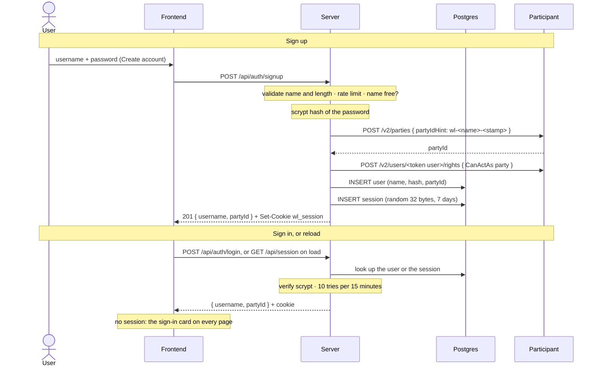
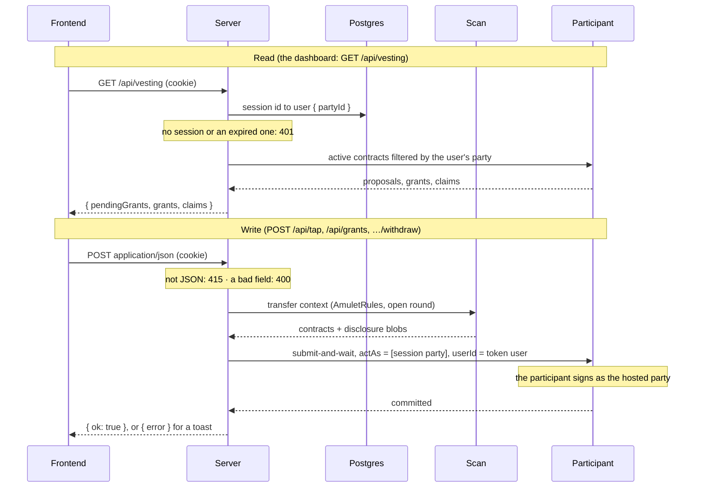

# Architecture of the wallet-less vesting dApp

The app's internal seams and the reasoning behind them. What this is and how to run it is in
[`README.md`](README.md). The rules every example shares are in [`../CLAUDE.md`](../CLAUDE.md), and
the cross-component picture in [`../../architecture.md`](../../architecture.md).

The vesting pages, the kit seam, the widgets and the stylesheet are
[amulet-vesting's](https://github.com/BootNodeDev/canton-dappbooster/blob/main/example-dapps/amulet-vesting/architecture.md),
unchanged. This page covers what replaces the wallet: a server that holds the accounts and acts on
the ledger as each one's party.

## Parts

| Path | Role |
|------|------|
| `server/src/app.ts` | The HTTP API on Hono: auth, the session middleware, and one route per vesting action. Every route after the middleware acts as the session's party. |
| `server/src/index.ts` | Wires the app to Postgres and the ledger, caches the deployment, and serves it on `WL_SERVER_PORT`. |
| `server/src/env.ts` | Every variable the server reads, loaded from this folder's `.env`. |
| `server/src/auth/` | `db.ts`, the Postgres store for users, sessions and escrow disclosures; `password.ts`, scrypt hashes; `provision.ts`, what a signup creates on the ledger. |
| `server/src/db/` | `schema.sql`, which `migrate.ts` applies, and `testDb.ts`, the PGlite database the tests run on. |
| `server/src/ledger/` | `LedgerBackend`, the vesting reads and writes; `client.ts`, the JSON Ledger API spoken directly; `token.ts`, where the bearer comes from; `config.ts`, which finds the deployment; `transferContext.ts`, the two Scan reads an Amulet-moving choice needs; the mappers and command builders. |
| `server/src/domain/` | The types the API hands over, which the dApp imports as types only, and the amount helpers. |
| `server/compose.yaml` | The local Postgres on 5433, which `scripts/server.sh` starts and stops. |
| `src/backend/` | `api.ts`, the one `fetch` wrapper, and `vesting.ts`, one function per route. Neither names a party. |
| `src/providers/` | `Session` asks who is signed in and holds the sign-in and sign-out actions; `Backend` asks the server whether the deployment is there. |
| `src/hooks/useReceiver.ts` | Resolves the grant form's receiver from a username or a full party id. |
| `src/components/AuthCard.tsx` | The sign-in and create-account card, which `SignInPrompt` puts on every page while nobody is signed in. |

Everything else under `src/` is amulet-vesting's, with the wallet code taken out.

## The session

A signup or a login starts a session: a random 32-byte id in the `wl_session` cookie, `httpOnly`
and `SameSite=Lax`, valid for seven days. Postgres keeps the id and its user, and a new session
purges the expired ones, so nothing runs on a timer. The password never leaves the server, and the
browser never sees a ledger token.

`Session` asks `GET /api/session` once on load, so a reload keeps the session. Any later
call that comes back 401 tells it the session is gone, through `onSessionExpired` in
`backend/api.ts`, and every page falls back to the sign-in card. `Backend` only asks
`GET /api/status` once someone is signed in, and asks again every five seconds while the deployment
is missing, so a `bootstrap` run after the page loaded shows up without a reload.

A login for an unknown name gets the same 401 as a wrong password, without hashing anything. A
decoy hash would hide which names exist, but a signup already answers 409 for a taken one, and any
signed-in account can look a name up.

## The HTTP API

Every route but auth and `GET /api/status` sits behind the session middleware, which turns the
cookie into a user and refuses the request with 401 otherwise. A route then acts as that user's
party and takes no party from the request: the receiver of a new grant is the only party a body
carries, and it is the counterparty, never the actor.

Every write must be `content-type: application/json`, or it gets 415. A cross-site form can post
urlencoded, multipart or text, but not JSON without a preflight, so this is the CSRF check on top of
the `SameSite` cookie. `validate.ts` checks every body field and throws a 400 that names it.
Signups are limited to 10 per client in 15 minutes, and logins to 10 per client and username:
room for typos, too few to guess a password. The limiter keys on the socket address, which behind a
proxy is the proxy.

`GET /api/grants/:cid/claims` walks back from the grant asked about through each withdraw's
`replaces`, because a withdraw archives the grant and creates its successor. The records come
newest first.

The Vite dev server proxies `/api` to `WL_SERVER_PORT`, so the dApp and the API share an origin and
the cookie travels without CORS. The route list is in [`README.md`](README.md#how-it-works).

## The ledger client and its token

`ledger/client.ts` speaks the JSON Ledger API directly. It fills a `{name}` in the resource from
`path`, sends the bearer `token.ts` hands it per request, and records each submission against
the token's own user, which the participant requires. `index.ts` asks `/v2/authenticated-user` for
it once, as the bootstrap does, rather than guessing it from the provider. `WalletFns` keeps the
shape a wallet session has, so `LedgerBackend` takes `execute` and `ledgerApi` as plain functions
and its tests need no network.

The server acts through one participant user, the one its token names. A signup allocates a party
hosted on the participant, so the participant signs for it and nobody holds a key, and grants that
one user `CanActAs` on it. There is no ledger user per account, because a hosted validator's identity
provider issues tokens to its own clients only. A participant caps a user at 1000 rights, so one
deployment holds at most 1000 accounts.

Where the token comes from:

- **LocalNet:** `CANTON_BACKEND_TOKEN` from `.env` when it is set, which `pnpm stack up` mints.
  Otherwise the server signs a short-lived HS256 token for `ledger-api-user` itself, from
  `CANTON_AUTH_AUDIENCE` and `CANTON_AUTH_SECRET`, the same recipe `mint-token` uses.
- **A hosted validator:** setting any `EXTERNAL_OAUTH_*` key switches to a client-credentials grant.
  The token is cached until a minute before it expires, and a burst of calls on an expired one makes
  one request. On this path `CANTON_JSON_API_URL` and `SPLICE_SCAN_API_URL` have no default.

## The escrow disclosure between create and accept

A grant pledges exactly one Amulet: `createVesting` first splits off an Amulet of exactly the grant
with `AmuletRules_Transfer`, then exercises `AmuletVestingFactory_CreateVesting` with its contract
id. The receiver's `AmuletVestingProposal_Accept` then has to disclose that Amulet, which the
receiver cannot read. The wallet example keeps the blob in the funder's browser, which ties both
sides to one browser. Here `LedgerBackend` puts it in the `escrow_disclosures` table at create,
reads it back at accept, and drops it once the Amulet is locked, so the funder and the receiver can
be anywhere. The row goes in before the proposal is submitted, since a row nothing pledges is never
read while a lost one strands the proposal. A funder's grants are created one at a time: a second
split would spend the first one's escrow before its proposal pledges it.

The split needs no headroom: Splice values an Amulet input at its full `initialAmount`, and only
`Amulet_Expire` charges the holding fee, as
[amulet-vesting's](https://github.com/BootNodeDev/canton-dappbooster/blob/main/example-dapps/amulet-vesting/architecture.md)
explains.

## Where the deployment comes from

Nothing is written to a file. The bootstrap grants the token's user `CanActAs` on the operator, so
`ledger/config.ts` reads that user's rights, takes the party under the `vesting-operator::` hint, and reads that operator's `AmuletVestingFactory` with its
created-event blob. `index.ts` keeps the result, but not a failure, so a `bootstrap` run after the
server started counts on the next request. `GET /api/status` reports either.

`scripts/bootstrap-vesting.mjs` creates the operator and the factory only where they are missing,
under a stable hint, because `pnpm stack up` runs it on every start and the LocalNet keeps its
ledger across a `down`. The match includes the `::` separator, so the stamped
`vesting-operator-<stamp>` parties amulet-vesting's bootstrap creates on a shared LocalNet are never
picked up. Both examples build the same DAR, so either one's upload serves both.

## The store and the pages

- `useVestingStore` reads again after every write. A claim archives the contract and creates its
  successor with the claimed figure raised, so the store finds the successor by lineage: every field
  but that figure.
- `trackSuccessor` records the ids before the write and takes, from the next read, the one new id
  with the same lineage. That also tells apart two identical grants from one funder.
- A withdraw that drains a residual claim archives it outright, so it has no successor.
- `busy` records the exit each contract has in flight. A dialog can close while its request is still
  out, and the control behind it would otherwise offer the same exit again.
- A failed read keeps the last good rows on screen, so `ReadError` shows a "may be out of date"
  banner with a retry above them.
- The create form has no token picker. A grant always vests Amulet, and the amount is capped at the
  funder's free Amulet, read from `GET /api/balance` when the form opens.
- The receiver field shows a format error only once it loses focus, but "No user named …" as soon as
  the delayed lookup answers.
- `AmountDisplay` scales the token mark with its figure, except on `KpiCard`, which passes
  `fixedMark` so the marks stay one size.

## Custody

The participant holds signing authority for every account's party, and the server decides which
party a request acts as. Whoever runs the two holds every account's Canton Coin: that is what
needing no wallet costs. External parties with keys the server holds would be the step toward
self-custody, and a larger one than this example takes.
