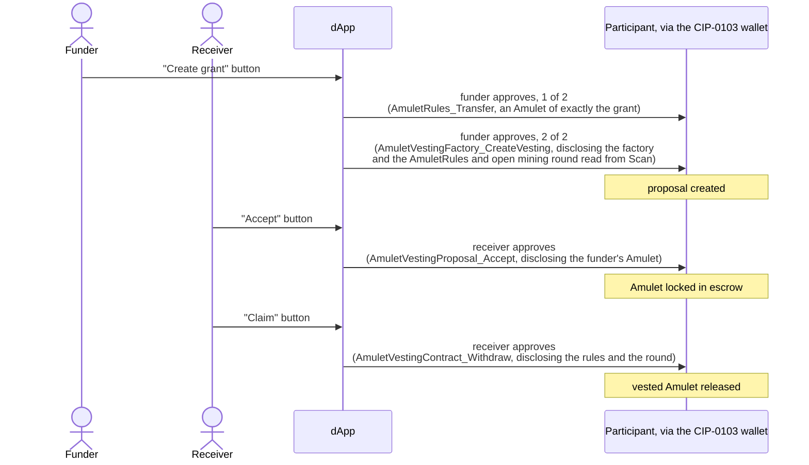

# Amulet vesting dApp

> [Canton dAppBooster](https://dappbooster.cc) is an open-source stack by BootNode for building Canton dApps on your own machine: a local Canton Network stack, wagmi-style hooks, UI components and CIP-0103 wallet support, wired together from the local network up to the UI. The installer, the guides and the rest of the stack live at [dappbooster.cc](https://dappbooster.cc).

`@bootnodedev/canton-example-amulet-vesting` is a vesting dApp for Canton Coin (Amulet), built with Canton dAppBooster.

> [!NOTE]
> The contract ships as source in [`daml/`](daml/), not as a DAR: it moves Canton Coin, so it must be built against the Splice release your network runs. [`daml/README.md`](daml/README.md) covers the build.

## Run the app

You need Node 24.15 or later, pnpm, the Daml SDK 3.5 (`dpm`), and Docker running.

1. Create a project from this example, with the local network.

   ```bash
   pnpm create canton-dappbooster --example amulet-vesting --localnet
   ```

2. In the project folder, start everything (LocalNet, contract, Wallet Gateway and dApp).

   ```bash
   pnpm stack up
   ```

3. Open http://localhost:3012, pick Wallet Gateway in the wallet picker and log in with the client secret `unsafe`. Create each party in the gateway with the `wallet-kernel` signing provider (with `participant`, the validator merges the party's Amulets and accepting a grant fails).
4. In the account menu, use **Tap Amulet** to get 100 AMT. After a fresh LocalNet start, it fails until the first mining round opens, about ten minutes later.
5. Create a grant for a second party from the gateway. To accept and claim it, make that party the wallet's primary party: the dApp acts as whichever party the wallet reports.

## How it works



Acceptance locks the funder's Amulet in escrow, and each claim releases part of it, so the figures on screen are real holdings. Each grant shows its vested and claimable amounts live, as [`src/utils/schedule.ts`](src/utils/schedule.ts) computes them.

Each write raises a real approval prompt in the wallet, and the wallet restores the session on reload.

## Configure the app

The app reads its variables from `.env` in the project folder, and [`.env.example`](.env.example) lists them. The URL variables default to the local stack.

### Use your own network

Point `.env` at your network: `CANTON_JSON_API_URL`, `CANTON_BACKEND_TOKEN`, the `VITE_` URLs, and `SPLICE_TAG` for the contract build. Build and deploy the contract as [`daml/README.md`](daml/README.md) describes, then run:

| Script | What it does |
| --- | --- |
| `pnpm bootstrap` | creates the operator and its factory |
| `pnpm dev` | serves http://localhost:3012 |

`bootstrap` writes no file: the dApp reads the operator and its factory back off the ledger once a wallet connects. The **Tap Amulet** faucet only works where `AmuletRules_DevNet_Tap` exists: LocalNet and DevNet.

### Turn on WalletConnect

WalletConnect is off by default. Set `VITE_WALLET_CONNECT_PROJECT_ID` to a [Reown](https://cloud.reown.com) project id to turn it on, and `VITE_NETWORK_ID` to the network the wallet serves: `canton:localnet` for the local gateway.

[`architecture.md`](https://github.com/BootNodeDev/canton-dappbooster/blob/main/example-dapps/amulet-vesting/architecture.md) describes the app's internal structure and the reasoning behind it, including how the dApp finds the operator and its factory on the ledger.
