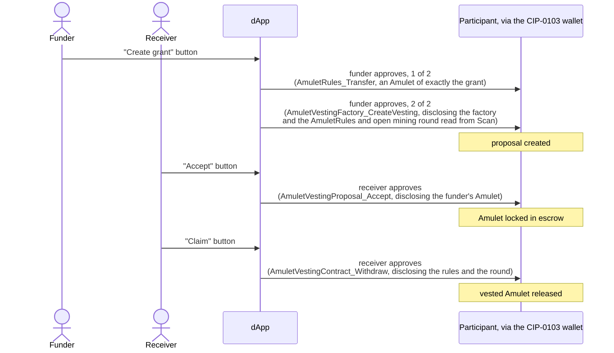

# Amulet vesting dApp

> [Canton dAppBooster](https://dappbooster.cc) is an open-source stack by BootNode for building Canton dApps on your own machine: a local Canton Network stack, wagmi-style hooks, UI components and CIP-0103 wallet support, wired together from the local network up to the UI. This package is its Canton Coin vesting example. The complete kit, the installer and the guides live at [dappbooster.cc](https://dappbooster.cc).

`@bootnodedev/canton-example-amulet-vesting` is a dApp for Amulet vesting. A funder proposes a grant and the receiver accepts it. The receiver claims Amulet as the grant vests. If the funder cancels the grant, the receiver keeps the vested but unclaimed Amulet as a residual claim.

Its Daml model is in [`daml/`](daml/), and [`daml/README.md`](daml/README.md) covers the build.

> [!NOTE]
> The model ships as source, not as a binary: it moves Canton Coin, so it must be built against the Splice release your network runs.

## How it works

Acceptance locks the funder's Amulet in escrow, and each claim releases part of it. The figures on screen are therefore real holdings. Each grant shows its vested and claimable amounts live, and [`src/utils/schedule.ts`](src/utils/schedule.ts) computes them.

## Run the app

### With the installer

`pnpm create canton-dappbooster --example amulet-vesting` makes a project from this package. With `--localnet`, `pnpm stack up` starts the app and everything it needs. The Local network section the installer appends to this README describes it.

### On your own network

Point `.env` at your network first: `CANTON_JSON_API_URL`, `CANTON_BACKEND_TOKEN`, the `VITE_` URLs, and `SPLICE_TAG` for the contract build. Then build and deploy the contract as the Contract section the installer appends describes, and run:

| Script | What it does |
| --- | --- |
| `pnpm bootstrap` | creates the operator and its factory |
| `pnpm dev` | serves http://localhost:3012 |

`bootstrap` writes no file: the dApp reads the operator and its factory back off the ledger once a wallet connects. [`architecture.md`](https://github.com/BootNodeDev/canton-dappbooster/blob/main/example-dapps/amulet-vesting/architecture.md) explains how it finds them.

## Use the app

### Connect a wallet

Every read and every write goes through the connected CIP-0103 wallet. The app acts as the wallet's primary account, and each write raises a real approval prompt. There is no mock mode. Without a connected wallet, the top bar guides you to connect one. When the ledger has no vesting operator and factory, the pages show a `No deployment` card.

With the local network, `pnpm stack up` starts Wallet Gateway on http://localhost:3030.

> [!WARNING]
> When you create a party in Wallet Gateway, choose the `wallet-kernel` signing provider. With `participant`, the validator merges the party's Amulets, and accepting a pending grant then fails.

You act as the party the wallet reports, and the wallet restores the session on reload. If you change the wallet's primary party, the dApp acts as the new one.

### Get Amulet

Funding a grant takes Amulet. The **Tap Amulet** faucet in the account menu taps 100 AMT into the connected party. It works on LocalNet and DevNet, where `AmuletRules_DevNet_Tap` exists.

> [!NOTE]
> The faucet fails until the first mining round opens, about ten minutes after a fresh LocalNet start.

## Configure the app

The app reads its variables from `.env` in the project folder, and [`.env.example`](.env.example) lists them. The URL variables default to the local stack.

WalletConnect is off unless you set `VITE_WALLET_CONNECT_PROJECT_ID` to a Reown project id. Once you set it, `VITE_NETWORK_ID` must match the network the wallet serves. For the local gateway, that is `canton:localnet`.

## Working on the package

### Scripts

| Script | What it does |
| --- | --- |
| `pnpm dev` | Vite dev server on http://localhost:3012 |
| `pnpm build` | `tsc -b`, then the Vite production build into `dist/` |
| `pnpm preview` | serves the production build |
| `pnpm test` | vitest, once |
| `pnpm test:watch` | vitest in watch mode |
| `pnpm typecheck` | `tsc -b --noEmit` |
| `pnpm bootstrap` | creates the operator and its factory on the ledger `.env` names |

Published to npm. The installer fetches that package with `npm pack`, not this folder. In the monorepo, `pnpm dev:amulet-vesting` from the root runs the installer's local network scripts against this folder, `build-dar` and `deploy-dar` included, which is why neither is a script here.

[`architecture.md`](https://github.com/BootNodeDev/canton-dappbooster/blob/main/example-dapps/amulet-vesting/architecture.md) describes the app's internal structure and the reasoning behind it, and [`PROVENANCE.md`](https://github.com/BootNodeDev/canton-dappbooster/blob/main/example-dapps/amulet-vesting/PROVENANCE.md) records where the frontend and the model came from.
