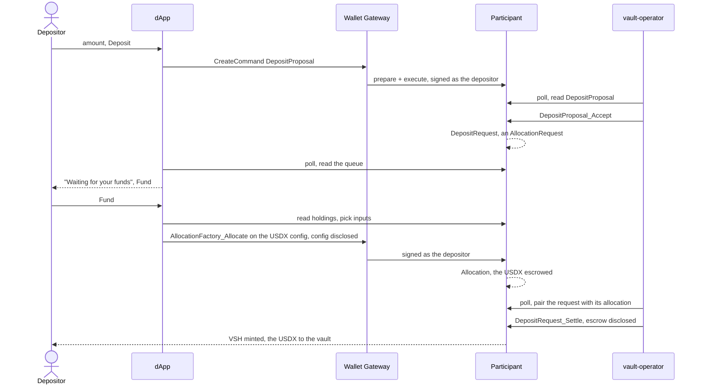
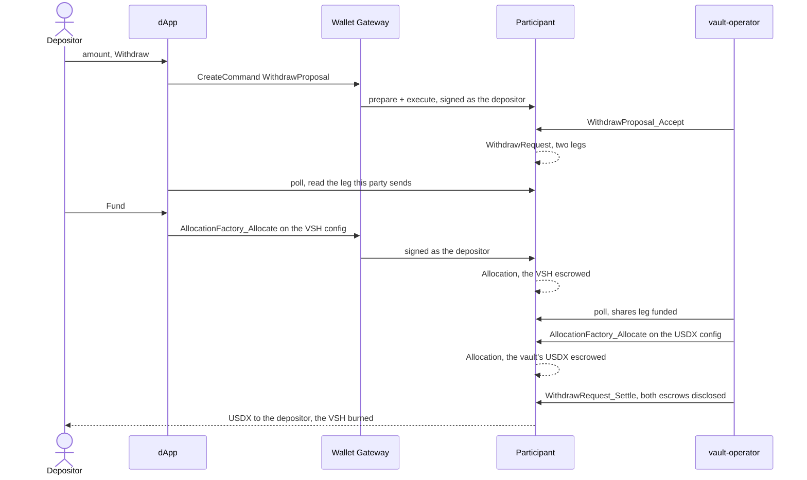

# Architecture of the token vault dApp

This page covers how the app works inside, and why. [`README.md`](README.md) says what it is and how
to run it. [`CLAUDE.md`](CLAUDE.md) has the rules for editing here, [`../../CLAUDE.md`](../../CLAUDE.md)
the repo-wide ones, and [`../../architecture.md`](../../architecture.md) the cross-component picture.

Two constraints shape everything below:

- **The wallet is the only way in.** The browser reads and submits only as the party the wallet
  reports.
- **The vault party is not a wallet account.** Both `*_Settle` choices are its to exercise, and a
  withdraw needs it to escrow its own `USDX`. So it is a participant-hosted party, and
  [`scripts/vault-operator.mjs`](scripts/vault-operator.mjs) acts as it.

Neither side can finish a deposit or a withdraw alone, so every flow here is a handoff between the
browser and the operator.

## Parts

| Path | Role |
|------|------|
| `src/backend/` | The `VaultBackend` interface and `LedgerBackend`, its one implementation. `wallet.ts` holds the `WalletFns` type and `acs.ts` the shared JSON Ledger API reads. `deployment.ts` runs the discovery, `requests.ts` reads the queue and `commands.ts` builds the commands. `selectInputs.ts` picks the holdings that fund an allocation. |
| `src/providers/` | `Backend` waits for a wallet party, loads the deployment and builds the backend from it. It offers a retry, and only the newest load lands. `Tokens` sits inside it and builds the token list from the deployment's two tokens and the party's holdings, for the kit's `TokenListProvider`. It also reads the vault's own `USDX` balance through the kit's `readHoldings`. |
| `src/store/useVaultStore.ts` | The queue as zustand state, plus `useVault`, which ties it to the backend and the party and reads it every five seconds. Every write submits, then reads again. |
| `src/utils/requestState.ts` | Turns a proposal or a request into the state its row shows and the action it offers. |
| `src/components/` | The shell from token-vesting, renamed to Canton Vault. It holds the top bar with its account menu, the footer, the toaster, and the parts more than one place renders. The account menu's Tap item is the faucet. |
| `src/pages/Vault/` | The one page. `index.tsx` composes the balances, the two proposal forms, the queue and the ledger facts; its siblings are what only it renders. |
| `scripts/` | `bootstrap-vault.mjs` and `vault-operator.mjs`, the JSON Ledger API client both share in `ledger-api.mjs`, the operator's decisions in `vault-decisions.mjs`, and `operator.sh`, which `stack:up` and `stack:down` run. |
| `vendor/` | The two DARs. Nothing here compiles them. |

## The committed DARs

`vendor/` holds the app's two Daml packages as binaries, so running it needs no `dpm`. The bootstrap
uploads both, the forge first so a failed upload names the token registry; the vault does not
depend on it.

| | `canton-token-forge.dar` | `canton-token-vault.dar` |
|---|---|---|
| Source | [`canton-token-forge`](https://github.com/BootNodeDev/canton-token-forge) | not published yet |
| Release | `v0.3.0` | not published yet |
| Asset | `canton-token-forge-0.0.1.dar` | `canton-token-vault-0.0.1.dar` |
| Size | 725807 bytes | 589329 bytes |
| sha256 | `147835e775e523f78c784996c43500c57e1ed97bcab97c97df6515b65f9332da` | `234c943a09e7dccfe115e3642e041829da825f27c92d7c85f76f0ba37811924b` |
| Package id | `20d54824dc4d76694c70ac51dd5f0b9e063ab789ffa02d07432abb848c8360cc` | `ace3978adadbf81b8166a869cc1b7c1fc594fd03e1999d03b4a084eb67bcff6f` |
| Built against | Splice `0.6.7` (commit `c8d8d977794c514ed2ee9eb64de322a6779898f3`) | the `splice-api-token-*` interfaces it bundles |
| Daml SDK | 3.4.11 | 3.4.11, built with `dpm` 1.0.21 |
| LF target | 2.1 | 2.1 |

- `canton-token-forge.dar` is byte-identical to token-vesting's.
- `canton-token-vault.dar` bundles the `holding`, `metadata`, `allocation`, `allocation-request`
  and `burn-mint` interface packages of `splice-api-token-*-v1`, at the package ids the forge DAR
  bundles. It has no `canton-token-forge` dependency: any CIP-0056 registry could issue its tokens.
- Neither needs a Splice DAR uploaded on its own.

## The three interfaces

- **`VaultBackend`** ([`src/backend/VaultBackend.ts`](src/backend/VaultBackend.ts)) is what the UI
  depends on. It speaks proposals, requests, holdings and the five actions a depositor takes: tap,
  deposit, withdraw, cancel and allocate. `LedgerBackend` implements it against the
  `canton-token-vault` package, so no component knows the ledger exists.
- **`WalletFns`** ([`src/backend/wallet.ts`](src/backend/wallet.ts)) is the pair of session calls
  `LedgerBackend` makes, `execute` and `ledgerApi`. They come from `canton-connect`'s `useExecute`
  and `useLedger`. `Backend` passes them in, because a class cannot call hooks and its tests build
  it without React.
- **`acs.ts`** ([`src/backend/acs.ts`](src/backend/acs.ts)) is where the discovery and the queue
  meet the JSON Ledger API. It owns `call`, the one place that casts a `ledgerApi` answer to a type,
  plus the active-contracts body and the two filter builders.

## Discovery

No `VITE_*` variable names the vault, and the bootstrap writes no file. A stale copy would show as
an empty page with no error. Instead,
[`deployment.ts`](src/backend/deployment.ts) reads the deployment through the wallet's own
`ledgerApi` each time a party connects:

1. The authenticated user's rights, through `/v2/users/{user-id}/rights` with the id in `path`. The
   Wallet Gateway refuses the route with the id written into it. The vault is the `CanActAs` party
   whose id starts with `vault-operator::`.
2. The ledger end, which every read below uses, so one load sees one ledger state.
3. The `Vault` contract that party created. The vault package id comes off its `templateId`.
4. Both `InstrumentConfig` contracts, read as their admins with their `createdEventBlob`. Their
   `instrumentId`s come off the Vault, never off the rights, so the pair is the one this vault
   names. Each one's `templateId` and blob make the disclosure a tap or an allocation sends, and
   the faucet's `maxPerTap` is the amount the Tap item asks for.

The browser reads the rights and the issuer's contracts as `ledger-api-user`, which the bootstrap
granted `CanActAs` on both parties. That is a local network shortcut. token-vesting takes the same
one to read its factory as the operator, and it is why this stack runs no token registry.

Discovery needs a session to read through, so the page shows the connect prompt until a party
connects. A failure is an error card with a retry, naming `pnpm run bootstrap`.

## Deposit

`LedgerBackend.allocate` picks the input holdings itself, off a fresh read
([`selectInputs.ts`](src/backend/selectInputs.ts)): largest first, so the command names as few as
it can, and never a locked one. It sends the request's own `requestedAt`, not the browser's clock,
because the factory checks that the request time lies in the past.

## Withdraw

The same steps pointed the other way, with one more: the request has two legs, and the second is
the vault's own to fund.

- The operator funds the payout leg only after the depositor funded the shares leg. Funding it
  first would lock the vault's `USDX` against a withdraw nobody may finish, until `settleBefore`.
- It funds the payout leg before it looks for pairs to settle, so a withdraw funded in one tick
  settles in the next.
- The browser sees none of this. A deposit and a withdraw are one code path in
  [`requests.ts`](src/backend/requests.ts): in both, the party owes exactly the leg it sends.

## What keeps the two views honest

The browser and the operator read the same ledger at their own pace, so a row must not lie in
between:

- **The browser reads the queue through the `AllocationRequest` interface.** Its view carries the settlement
  and the leg, which go into the allocation unchanged, because `*_Settle` compares them field by
  field.
- **`requests.ts` scopes the queue twice.** The interface filter matches every `AllocationRequest`
  on the ledger. So the settlement's `executor` must be this vault, and the leg must be one the
  settle choices name: `deposit` or `withdraw-shares-in`.
- **All four queue reads share one offset.** At four offsets an allocation could show for a
  request the queue had not seen, and the queue would offer to fund a leg twice.
- **A leg counts as funded when the party's own `Allocation` names its settlement reference and leg
  id**, the same pair the settle choice compares.
- **Only the newest read lands.** The store bumps an epoch on every refresh and on `clear`.
  `Tokens` does the same for the vault's balance read. A slow read for a party that has left then
  cannot overwrite a fresh one.
- **One function decides a row's state**, [`requestState.ts`](src/utils/requestState.ts):
  - before the allocation, the depositor owes it, until `allocateBefore`;
  - after it, the vault owes the settle, until `settleBefore`;
  - past either deadline, the request is dead.
- **Every write reads again rather than editing a row.** A proposal becomes a request under a new
  contract id, and an allocation is a contract of its own that the row only reports on.
- **The balances read again when the queue changes**, not on every tick. A settle archives the
  request and moves the tokens in one transaction, so a queue change is a balance change.

## The bootstrap

[`scripts/bootstrap-vault.mjs`](scripts/bootstrap-vault.mjs) runs on every `pnpm stack up`, and
the LocalNet's volumes outlive a `down`. So it creates only what is missing:

- it uploads both DARs;
- it finds the `token-issuer` and `vault-operator` parties through `/v2/parties`, by hint and
  `isLocal`, and allocates either only when missing;
- it grants the authenticated user `CanActAs` on both, every time;
- it creates three contracts, each only when missing:
  - the `USDX` config, with the issuer as `admin` and a faucet of 1000 per tap;
  - the `VSH` config, with the vault as `admin` and no faucet;
  - the `Vault`;
- it warns when a config it finds differs from what it would create. The issuer signs a config
  once, so a change reaches the ledger only through a reset.

Two parties rather than one, because the Vault only requires the share token's admin to be the
vault. A vault that issued its own `USDX` too would hide the disclosure a deposit really needs.

## The operator's own guards

[`scripts/vault-decisions.mjs`](scripts/vault-decisions.mjs) holds the operator's decisions, with
no I/O and no state, so their tests need no ledger. The loop in
[`scripts/vault-operator.mjs`](scripts/vault-operator.mjs) acts on them:

- It finds the vault the way the dApp does, then reads both configs once, at start.
- It needs no lock. Every choice it exercises consumes its contract, so of two attempts on one
  contract the second fails with `CONTRACT_NOT_FOUND`, which the loop logs and skips.
- Every command id carries a fresh timestamp, so the participant never drops a genuine retry as a
  duplicate.
- One item failing is that item's problem: the loop keeps going for the rest.
- A settle discloses each escrow, read as the admin of that leg's token, who signs it. A withdraw's
  two escrows have different admins.
- Ticks run one after another, never on an interval, so a slow tick cannot overlap the next.
- `scripts/operator.sh` restarts a running operator rather than reusing it, since one left from an
  earlier run may hold a vault a reset has since dropped.
