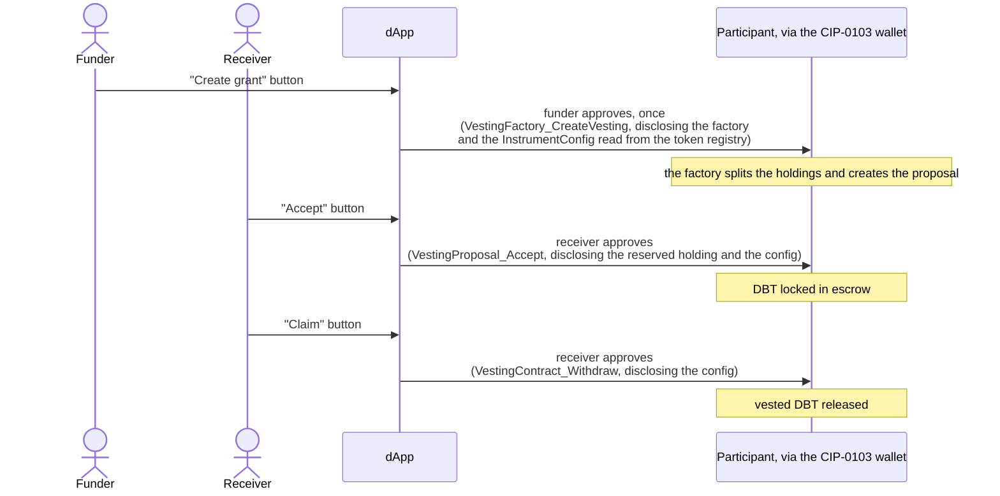

# Token vesting dApp

> [Canton dAppBooster](https://dappbooster.cc) is an open-source stack by BootNode for building Canton dApps on your own machine: a local Canton Network stack, wagmi-style hooks, UI components and CIP-0103 wallet support, wired together from the local network up to the UI. The installer, the guides and the rest of the stack live at [dappbooster.cc](https://dappbooster.cc).

`@bootnodedev/canton-example-token-vesting` is a dApp for vesting a [canton-token-forge](https://github.com/BootNodeDev/canton-token-forge) token, `DBT`. A funder proposes a grant, and the receiver accepts or declines it. The funder can cancel it until the receiver accepts. The receiver claims `DBT` as the grant vests. If the funder cancels an accepted grant, the receiver keeps the vested but unclaimed `DBT` as a residual claim.

The Daml packages ship prebuilt in [`vendor/`](vendor/), and `bootstrap` uploads them: the vesting model from [canton-vesting-forge](https://github.com/BootNodeDev/canton-vesting-forge) and the token from [canton-token-forge](https://github.com/BootNodeDev/canton-token-forge). A canton-token-forge registry serves the token's metadata. [`vendor/PROVENANCE.md`](vendor/PROVENANCE.md) records their releases and checksums.

> [!NOTE]
> There is no `daml/` here. Nothing in those packages depends on the Splice release your network runs, so one build works on any network and the app needs no Daml toolchain.

## How it works

Acceptance locks the funder's `DBT` in a `LockedToken` escrow, and each claim releases part of it. The figures on screen are therefore real holdings. Each grant shows its vested and claimable amounts live, and [`src/utils/schedule.ts`](src/utils/schedule.ts) computes them.

## Run the app

### With the installer

`pnpm create canton-dappbooster --example token-vesting` makes a project from this package. With `--localnet`, `pnpm stack up` starts the app and everything it needs, the token registry on http://localhost:3013 included. The Local network section the installer appends to this README describes it.

### On your own network

Point `.env` at your network first: `CANTON_JSON_API_URL`, `CANTON_BACKEND_TOKEN` and the `VITE_` URLs. Then run:

| Script | What it does |
| --- | --- |
| `pnpm bootstrap` | uploads the DARs, creates the operator, its factory and the DBT instrument |
| `pnpm stack:up` | starts the token registry on http://localhost:3013 |
| `pnpm dev` | serves http://localhost:3012 |

`bootstrap` creates only what is missing, so running it again is safe. The one file it writes is `.env.registry`, the registry's settings, which `stack:up` starts the registry from. `pnpm stack:down` stops it. [`architecture.md`](https://github.com/BootNodeDev/canton-dappbooster/blob/main/example-dapps/token-vesting/architecture.md) explains how the dApp finds the operator and the factory on the ledger.

## Use the app

### Connect a wallet

Every read and every write goes through the connected CIP-0103 wallet. The app acts as the wallet's primary account, and each write raises a real approval prompt. There is no mock mode. Without a connected wallet, the top bar guides you to connect one. When the ledger has no vesting operator and factory, the pages show a `No deployment` card.

With the local network, `pnpm stack up` starts Wallet Gateway on http://localhost:3030.

You act as the party the wallet reports, and the wallet restores the session on reload. If you change the wallet's primary party, the dApp acts as the new one.

### Get DBT

Funding a grant takes `DBT`. The **Tap dAppBooster Token** faucet in the account menu taps 1000 DBT into the connected party, straight off the instrument's own config. The amount is fixed in the app, under the `maxPerTap` that `bootstrap` sets on the instrument.

## Configure the app

The app reads its variables from `.env` in the project folder, and [`.env.example`](.env.example) lists them. The explorer, registry and gateway URLs default to the local stack.

> [!NOTE]
> Open the dApp on any address other than http://localhost:3012 and the registry refuses it until `CORS_ORIGINS` lists that address.

WalletConnect is off unless you set `VITE_WALLET_CONNECT_PROJECT_ID` to a Reown project id. Once you set it, `VITE_NETWORK_ID` must match the network the wallet serves. For the local gateway, that is `canton:localnet`.

> [!NOTE]
> A build you deploy takes no defaults for the URL variables. With `DEPLOYED_BUILD=1`, an unset URL fails the build rather than baking in a `localhost` address that an https page blocks as mixed content. On Vercel, [`api/registry.ts`](api/registry.ts) forwards the registry's routes from the deployed origin to the registry `REGISTRY_URL` names. The Vercel block in `.env.example` lists what to set.

## Working on the package

### Scripts

| Script | What it does |
| --- | --- |
| `pnpm dev` | Vite dev server on http://localhost:3012 |
| `pnpm build` | `tsc -b`, then the Vite production build into `dist/` |
| `pnpm preview` | serves the production build |
| `pnpm test` | vitest, once, `scripts/bootstrap-vesting.test.mjs` included |
| `pnpm test:watch` | vitest in watch mode |
| `pnpm typecheck` | `tsc -b --noEmit` |
| `pnpm bootstrap` | uploads the DARs and creates the operator, its factory and the instrument on the ledger `.env` names |
| `pnpm stack:up` | starts the token registry from `.env.registry` |
| `pnpm stack:down` | stops it |

Published to npm. The installer fetches that package with `npm pack`, not this folder. In the monorepo, `pnpm dev:token-vesting` from the root runs the installer's local network scripts against this folder, and they call `stack:up` and `stack:down` around the registry.

[`architecture.md`](https://github.com/BootNodeDev/canton-dappbooster/blob/main/example-dapps/token-vesting/architecture.md) describes the app's internal structure and the reasoning behind it, and [`PROVENANCE.md`](https://github.com/BootNodeDev/canton-dappbooster/blob/main/example-dapps/token-vesting/PROVENANCE.md) records where the frontend came from.
